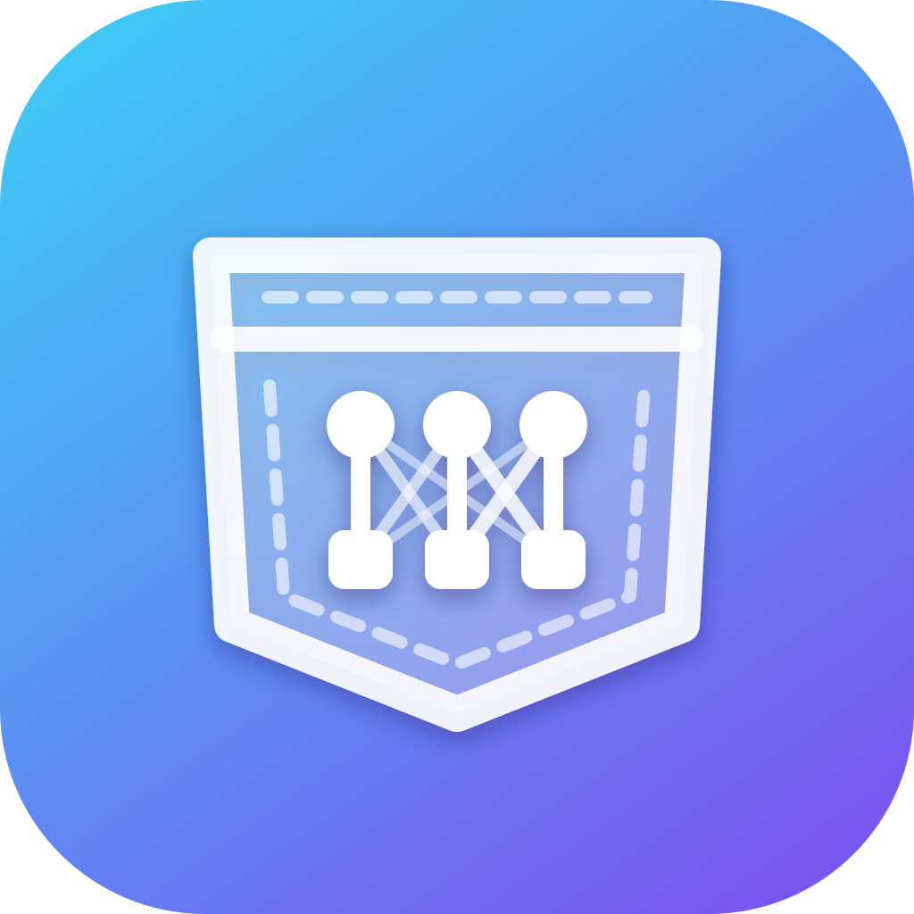

<p align="center">
  
</p>

<h1 align="center">Pocket LAI</h1>

<p align="center"><b>Local AI in your pocket.</b> Chat with open LLMs entirely on your iPhone. No cloud, no account, works offline.</p>

Pocket LAI (Local AI) is a SwiftUI chat app. It downloads open models from Hugging Face once, then runs them fully
on-device on the iPhone GPU with Apple's [MLX](https://github.com/ml-explore/mlx-swift) framework via
[mlx-swift-lm](https://github.com/ml-explore/mlx-swift-lm).
The design follows the MLX team's [MLXChatExample](https://github.com/ml-explore/mlx-swift-examples/tree/main/Applications/MLXChatExample),
which also handles both LLMs and vision models.

## Features
- **Any MLX model.** Built-in picks are recent small models: Qwen3.5, Gemma 4, Liquid LFM2.5, Ministral 3, Phi-4 mini, Granite 4.1, SmolLM3 and Llama 3.2.
  You can also paste any Hugging Face repo ID, for example `mlx-community/Ministral-3-3B-Reasoning-2512-4bit`.
- **Text and vision models load the same way.** The app tries the vision-model loader first, then the text-only one,
  so you never pick the type.
- **Photo input** for vision models (👁: every Qwen3.5 model, Gemma 4, LFM2.5-VL, Ministral 3).
  On a text-only model, the photo button explains which models can see images.
- **Text in, text out.** Vision models can *read* images, but no model here *generates* images.
- **Streaming replies** with a Stop button and tokens/sec stats.
- **Thinking mode** for reasoning models. Their `<think>` output appears in a collapsible section.
- **Custom system prompt.**

## Requirements
- A Mac with Xcode 26 or newer (mlx-swift-lm needs Swift 6.2). No Homebrew or other tools are needed.
- A physical iPhone. **MLX does not run in the iOS Simulator.**

## Build & run
```sh
git clone git@github.com:mgrossu/pocketlai.git
open pocketlai/PocketLAI.xcodeproj
```
1. Xcode fetches the Swift packages automatically. The first time takes a few minutes.
2. In the **PocketLAI** target, open **Signing & Capabilities** and pick your Team.
3. On the first build, Xcode asks you to **Trust & Enable** the `MLXHuggingFaceMacros` macro plugin. Accept it.
4. Plug in the iPhone, select it as the run destination, and press ⌘R.
   - On a first run, enable Developer Mode on the phone (Settings → Privacy & Security).
   - Then trust your developer certificate (Settings → General → VPN & Device Management).
5. Pick a model, then tap **Load**. The first load downloads the weights; after that the model works offline.

After that, the update loop is just `git pull`, then ⌘R. The project uses Xcode's synchronized folders,
so new files in `PocketLAI/` show up in Xcode automatically.

The shared scheme runs the **Release** configuration, because MLX is many times faster with optimizations on.
For breakpoints and step-through debugging, switch Run to Debug: Product → Scheme → Edit Scheme.

## Which models fit?
The iPhone 17 Pro has 12 GB of RAM. The picker shows each model's download size, which is roughly the RAM it needs:
- **Up to ~3 GB** (e.g. Qwen3.5 4B, Ministral 3 3B, Phi-4 mini) runs smoothly.
- **5–6 GB** (Gemma 4 E4B, Qwen3.5 9B, Ministral 3 8B) needs the increased-memory entitlement and leaves little headroom.
  LFM2.5 8B-A1B is a mixture-of-experts model with only 1B active, so it's fast despite its 4.8 GB size.
- **Gemma 4 12B (11 GB) and larger** are too big for the phone.

## Project layout
| File | Purpose |
|---|---|
| `PocketLAI/ModelCatalog.swift` | Built-in model list. Add entries here. |
| `PocketLAI/ChatModel.swift` | Model loading (`loadModelContainer`), chat session, streaming, custom repos |
| `PocketLAI/ChatView.swift` | Model picker, chat UI, settings, `<think>` rendering |
| `PocketLAI/PocketLAI.icon` | App icon (Icon Composer). `docs/icon.svg` is a flat preview of it for this README. |
| `PocketLAI.xcodeproj` | Xcode project: packages, build settings, entitlements, Info.plist keys |

## Notes
- **Free Apple ID:** if signing rejects `com.apple.developer.kernel.increased-memory-limit`, remove it from
  `PocketLAI/PocketLAI.entitlements`. Then stay at 4B or smaller.
- **Unsupported architectures:** a custom repo only loads if mlx-swift-lm supports its `model_type`.
  Otherwise the picker shows an "unsupported model type" error.
